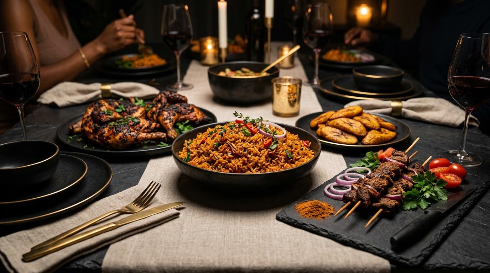

# TOLEX RESTAURANT — Luxury African Dining

An award-winning, responsive, four-page restaurant website designed and developed for **TOLEX RESTAURANT**, celebrating authentic African gastronomy, royal hospitality, and luxury modern aesthetics.



---

## 🌟 Brand & Visual Direction

- **Primary Background:** Matte Black (`#171717`) with subtle slate textural undertones.
- **Secondary Surfaces:** Charcoal Black (`#292929`) for luxury cards and interactive panels.
- **Accent & Highlights:** Golden Yellow (`#F5C51B`) for buttons, headings, ratings, and borders.
- **Typography:** Warm White (`#F5F2E9`) in serif display (`Cinzel`, `Playfair Display`) and sans-serif body (`Plus Jakarta Sans`).
- **Botanical Flourish:** Natural Leaf Green (`#788A35`) used sparingly on circular dish frames and fresh accents.

---

## 🏛️ Website Architecture (Four Pages)

1. **[index.html](index.html) — Home**
   - Signature **Slider Revolution-Style Animated Hero Slider** (Ken Burns zoom, line reveal text, slide progress bar, pause-on-hover, touch swipe).
   - Welcome & African Hospitality Introduction.
   - Food Categories Showcase with circular gold frames and natural leaf accents.
   - Interactive Menu with live category filter, instant keyword search, and modal dish inspection.
   - Why Choose Us (6 core pillars with gold icons).
   - Split Restaurant Experience showcase.
   - Food Gallery with full-screen Lightbox.
   - Customer Testimonials Carousel.
   - Final Call-to-Action & Luxury Footer.

2. **[about.html](about.html) — About Us**
   - Large culinary hero banner with authentic feast photography.
   - The Genesis & Story of TOLEX RESTAURANT.
   - Who We Are (Master chefs and custodians of African culinary art).
   - Mission & Vision dual gold cards.
   - Core Values (Ancestral Authenticity, Royal Hospitality, Freshness, Culinary Artistry, Cultural Pride).
   - Commitment to Quality (Zero artificial fillers, 100% pure African spices).
   - The Restaurant Experience & VIP Salons.

3. **[services.html](services.html) — Our Services**
   - Detailed showcase of all 7 restaurant services:
     1. Restaurant Dining
     2. Curated Food Menu & Tastings
     3. Food Ordering & Enquiries
     4. Table Reservations
     5. Takeaway & Express Pickup
     6. Event & Wedding Catering
     7. Private VIP Salons & Celebrations
   - **Interactive Catering Cost Estimator** (Interactive guest slider & instant WhatsApp quote generator).
   - Embedded interactive menu search & filter.

4. **[contact.html](contact.html) — Contact Us**
   - Contact Info Cards: Phone, WhatsApp, Email, Address, and Opening Hours.
   - **Table Reservation Form** with date/time pickers and dining notice.
   - **Customer Feedback & General Enquiry Form** with real-time validation.
   - Configurable Dark Slate Map Section with parking details.
   - Social Media Connect (Instagram, Facebook, TikTok, WhatsApp).

---

## 💻 Tech Stack

- **HTML5:** Semantic markup, accessibility attributes (`aria-*`, `role`).
- **CSS3:** Modern CSS variables, flexbox, grid, keyframes, transitions, and `prefers-reduced-motion` compliance.
- **Vanilla JavaScript:** Zero external framework dependencies. Custom Slider Revolution engine, interactive menu filtering, modal dialogs, WhatsApp order generation, and lightbox.

---

## 🚀 Getting Started

1. Clone or download this repository:
   ```bash
   git clone https://github.com/0Adetola2/tolex-restaurant.git
   ```
2. Open `index.html` in any modern web browser (Google Chrome, Microsoft Edge, Mozilla Firefox, Safari).
3. No build tools or package managers required.

---

© 2026 **TOLEX RESTAURANT**. All rights reserved.
